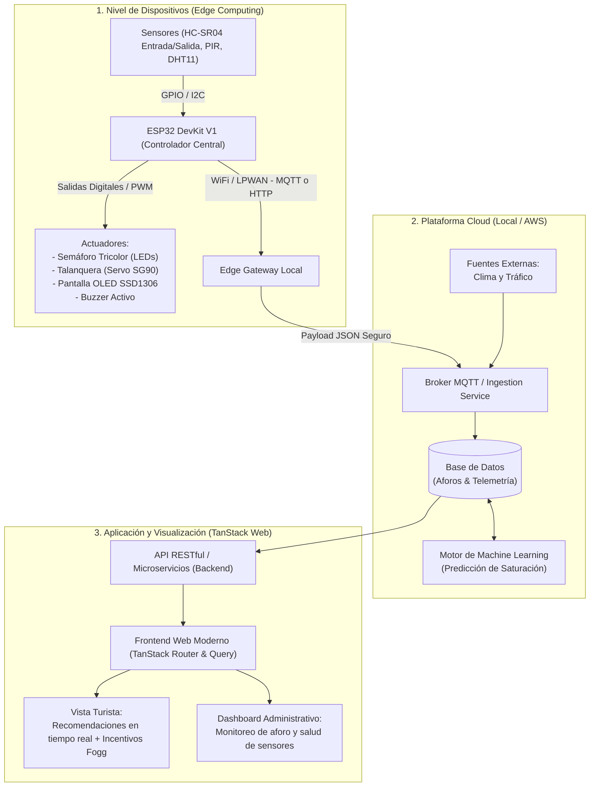

# OpTurize — Sistema IoT para monitoreo y descongestión de destinos turísticos

## Problemática

El turismo en el Perú experimenta una **centralización extrema** en un número reducido de atractivos icónicos (Machu Picchu, Centro Histórico de Lima, Valle Sagrado). Esta sobrecarga genera:
* **Hacinamiento y deterioro:** Desgaste acelerado del patrimonio arqueológico, histórico y reservas naturales al sobrepasar su capacidad de carga admisible.
* **Invisibilidad de destinos secundarios:** Cientos de huacas provinciales, paisajes naturales y sitios culturales alternativos carecen de difusión, afluencia constante e infraestructura de medición.
* **Inequidad económica:** La concentración de ingresos excluye a comunidades locales, artesanos, guías y pequeños negocios de distritos menos promovidos.

## Solución propuesta

**OpTurize** es una solución de Internet de las Cosas (IoT) y analítica predictiva distribuida en 3 niveles:

1. **Monitoreo de aforo no invasivo en tiempo real (Edge):** Dispositivos basados en microcontroladores ESP32 y sensores respetuosos de la privacidad (Edge AI / PIR / Ultrasonidos) instalados en los puntos de acceso a atractivos turísticos.
2. **Control físico y visual en el sitio:** Semáforo LED tricolor indicador de estado de aforo (Libre, Moderado, Lleno), talanquera automática (servomotor), buzzer sonoro y display OLED informativo.
3. **Procesamiento y Analítica (Cloud / Local - AWS):** Ingesta de telemetría vía MQTT/HTTP, almacenamiento de series de tiempo y modelos de Machine Learning que cruzan afluencia histórica con datos climáticos y tráfico local para anticipar picos de saturación.
4. **Persuasión conductual al turista (TanStack Web App):** Plataforma web moderna que notifica el estado en vivo y emplea el **Modelo de Comportamiento de Fogg** ($B = MAP$: Motivación, Habilidad y Disparador) para incentivar activamente el desvío planificado hacia destinos alternativos cercanos.

## Arquitectura del sistema



## Especificaciones de hardware (Capa Física)

Diseñado y verificado para simulación en **Wokwi** y prototipado físico sobre **ESP32 DevKit V1**:

| Componente | Tipo | Conexión ESP32 | Voltaje | Función |
| :--- | :--- | :--- | :--- | :--- |
| **HC-SR04 (Sensor A)** | Sensor Ultrasónico | Pin 5 (Trigger), Pin 18 (Echo) | 5V | Detección de paso al ingreso |
| **HC-SR04 (Sensor B)** | Sensor Ultrasónico | Pin 19 (Trigger), Pin 25 (Echo) | 5V | Detección de paso a la salida |
| **DHT11** | Sensor Ambiental | Pin 4 (Datos) | 3.3V | Monitoreo de temperatura y humedad |
| **SSD1306 (128x64)** | Pantalla OLED | Pin 21 (SDA), Pin 22 (SCL) | 3.3V | Despliegue visual local de aforo y clima |
| **LED Verde** | Actuador Visual | Pin 12 (+ Resistencia 220Ω) | 3.3V (GPIO) | Estado: *Acceso Libre* |
| **LED Amarillo** | Actuador Visual | Pin 14 (+ Resistencia 220Ω) | 3.3V (GPIO) | Estado: *Aforo Moderado (Alerta)* |
| **LED Rojo** | Actuador Visual | Pin 27 (+ Resistencia 220Ω) | 3.3V (GPIO) | Estado: *Aforo Máximo Superado* |
| **Servo SG90** | Actuador Mecánico | Pin 13 (PWM) | 5V | Talanquera / Barrera física de control |
| **Buzzer Activo** | Actuador Sonoro | Pin 23 (Digital) | 5V | Alarma sonora al superar aforo máximo |

### Estructura de telemetría (Payload MQTT/HTTP)

```json
{
  "id_dispositivo": "ESP32-GATEWAY-01",
  "conteo_aforo_actual": 38,
  "capacidad_maxima": 50,
  "estado_semaforo": "AMARILLO",
  "deteccion_pir": true,
  "temperatura": 22.4,
  "humedad": 75.0,
  "timestamp": "2026-09-20T16:00:00Z"
}
```

## Estructura del proyecto

```
opturize/
├── docs/                                                 # Documentación académica de laboratorios
│   ├── Laboratorio01.pdf                                 # Propuesta inicial y justificación del proyecto
│   ├── Laboratorio02.pdf                                 # Arquitectura general de 3 capas
│   ├── Laboratorio03.pdf                                 # Diseño físico, sensores y diagrama circuital
│   ├── Laboratorio04.pdf                                 # Complemento del laboratorio de sensores
│   └── Laboratorio05_Diseno_Comunicacion_Inalambrica.md # Diseño de la comunicación inalámbrica y telemetría
├── firmware/                                             # Código embebido ESP32 y simulación Wokwi
│   ├── sketch.ino                                        # Firmware Arduino/C++ para ESP32
│   ├── diagram.json                                      # Esquema circuital de simulación Wokwi
│   └── wokwi.toml                                        # Configuración de simulación Wokwi
├── src/
│   ├── backend/                                          # API REST, broker/cliente MQTT y lógica de datos
│   └── frontend/                                         # Aplicación web interactiva (TanStack Router & Query)
└── README.md                                             # Contexto, arquitectura y guía general del proyecto
```

## Hoja de ruta (Roadmap de implementación)

- [x] **Fase 0: Definición y Diseño Conceptual**
  - [x] Identificación de problemática y propuesta de solución (Lab 01).
  - [x] Arquitectura de 3 capas Edge-Cloud-App (Lab 02).
  - [x] Diseño físico de sensores, actuadores y circuito Wokwi (Lab 03 & 04).
  - [x] Diseño de la comunicación inalámbrica, matriz comparativa y telemetría (Lab 05).
- [x] **Fase 1: Simulación Física e Interactiva (Firmware)**
  - [x] Implementación de `sketch.ino` en C++ para ESP32.
  - [x] Configuración del circuito en `diagram.json` para Wokwi.
  - [x] Validación de la máquina de estados de aforo (Libre, Moderado, Lleno) y actuadores.
- [x] **Fase 2: Backend y Telemetría Local**
  - [x] Receptor de telemetría MQTT/HTTP (`src/backend/`).
  - [x] Persistencia de eventos de aforo y cálculo de métricas en tiempo real.
  - [x] API REST para consulta de atractivos y saturación.
- [x] **Fase 3: Frontend Web React, Vite, Zustand, Zod & Visx**
  - [x] Interfaz web SPA con Vite, React, TypeScript y TailwindCSS (fuente DM Sans, sin emojis).
  - [x] Gestión de estado con Zustand stores y validación estricta Zod sobre fetch nativo.
  - [x] Dashboard de control dual: Modo Turista (catálogo y mapa de calor) y Modo Gestor (control ESP32 / MQTT).
  - [x] Gráficos estadísticos con `@visx` (Airbnb) y mapa de calor geoespacial con Leaflet.
  - [x] Módulo interactivo de recomendación persuasiva de destinos alternativos (Modelo de Fogg).
- [ ] **Fase 4: Modelo Predictivo & Preparación para AWS**
  - [ ] Modelo de predicción de afluencia cruzando histórico y clima.
  - [ ] Contenedorización con Docker para migración transparente a AWS (ECS/EC2/RDS).
