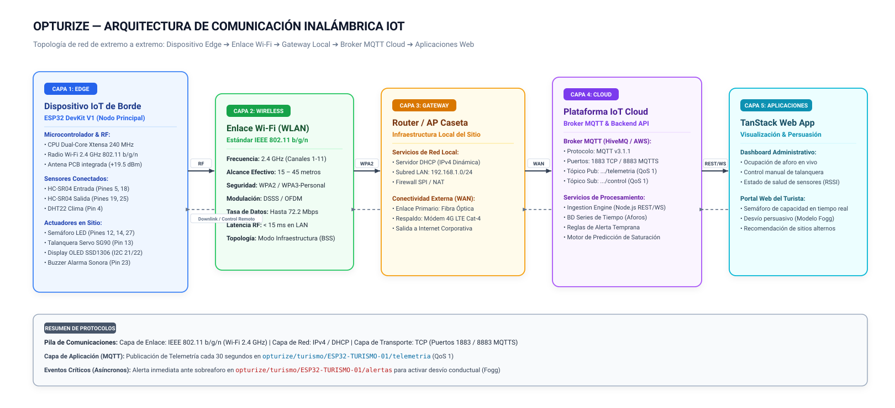
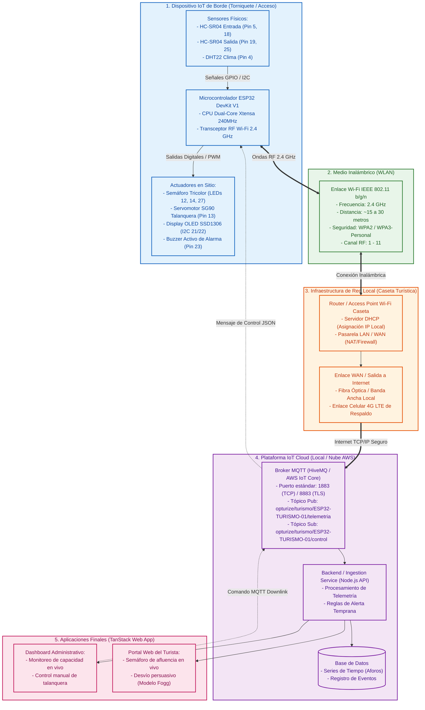

# DISEÑO DE LA COMUNICACIÓN INALÁMBRICA DEL PROYECTO IOT

## 1. Contexto del Proyecto
**OpTurize** es una solución IoT y de analítica predictiva diseñada para mitigar la saturación de los destinos turísticos emblemáticos en el Perú (como Machu Picchu o el Centro Histórico de Lima) y canalizar la afluencia hacia sitios arqueológicos y culturales alternativos (ej. Huaca Pucllana, Huaca Mateo Salado, Pachacamac). 

En los laboratorios anteriores se diseñó la arquitectura de 3 niveles (*Laboratorio 02*) y la capa física con microcontrolador **ESP32 DevKit V1**, sensores de aforo ultrasónicos (HC-SR04 ingreso y salida), sensor ambiental (DHT22), display OLED SSD1306, semáforo LED de estado (Verde, Amarillo, Rojo), servomotor SG90 como talanquera y buzzer sonoro (*Laboratorio 03 y 04*).

En el presente laboratorio se define y justifica formalmente la **capa de comunicación inalámbrica** que enlaza el dispositivo IoT desplegado en el punto de acceso del atractivo turístico con la infraestructura de red local y la plataforma en la nube.

---

## 2. Actividad 1: Identificación de la Necesidad de Comunicación

Para determinar la tecnología de conectividad más adecuada, se analizaron los parámetros operacionales y el entorno de despliegue físico del nodo sensor de OpTurize:

| Parámetro | Requerimiento / Condición en OpTurize | Análisis Técnico |
| :--- | :--- | :--- |
| **Ubicación física** | Casetas de control de acceso, torniquetes y portales peatonales de ingreso a sitios patrimoniales (ej. Huaca Pucllana). | Entorno semiabierto o techado, expuesto a variaciones térmicas moderadas, con suministro eléctrico continuo (220V AC convertido a 5V/3.3V DC para el nodo). |
| **Distancia de transmisión** | De 15 a 45 metros en línea de vista hacia el centro de control o caseta administrativa. | Corresponde a una red de área local (*LAN / WLAN*). No se requiere cobertura satelital de kilómetros directos desde el nodo final, sino enlace hacia el router/gateway del recinto. |
| **Disponibilidad de Internet** | Media - Alta en centros turísticos organizados; enlace satelital/celular en sitios remotos. | Las boleterías y oficinas administrativas de los museos de sitio disponen de servicio de Internet fijo (Fibra/ADSL) o routers móviles 4G LTE proporcionados por el Ministerio de Cultura o la administración del sitio. |
| **Frecuencia esperada de transmisión** | **Modo Híbrido:**<br>• Periódica: Cada 30 segundos (telemetría de aforo y clima).<br>• Por evento (*Event-driven*): Inmediata (< 500 ms) al detectar cruce de personas o al activarse el umbral de sobreaforo. | El sistema demanda latencia baja en eventos críticos (para sincronizar la señalización web y desviar visitantes en tiempo real antes de que se aglomeren), pero un volumen de datos moderado (cientos de bytes por paquete JSON). |

**Breve descripción de la necesidad:**
El sistema requiere una tecnología de enlace inalámbrico local que permita al microcontrolador ESP32 enviar paquetes de datos ligeros en formato JSON mediante protocolos de transporte estándar hacia un punto de acceso (Access Point/Router) situado a no más de 50 metros. La comunicación debe admitir tanto publicaciones periódicas de estado y clima como avisos asíncronos instantáneos ante eventos de saturación, operando sin requerir hardware adicional complejo ni costos de suscripción mensual por sensor.

---

## 3. Actividad 2: Comparación de Alternativas Tecnológicas

A continuación, se evalúan las principales alternativas inalámbricas disponibles en el ecosistema IoT frente a las necesidades técnicas y operativas del proyecto OpTurize:

| Criterio de Comparación | Wi-Fi (IEEE 802.11 b/g/n) | Bluetooth / BLE (IEEE 802.15.1) | Zigbee (IEEE 802.15.4) | Red Móvil Celular (4G LTE / NB-IoT) |
| :--- | :--- | :--- | :--- | :--- |
| **Banda de Frecuencia** | 2.4 GHz | 2.4 GHz ISM | 2.4 GHz / 868-915 MHz | Bandas celulares licenciadas (700 MHz - 2.6 GHz) |
| **Alcance Efectivo** | 30 – 100 metros (óptimo para perímetro de caseta) | 10 – 30 metros (punto a punto) | 10 – 75 metros (ampliable en malla) | Varios kilómetros (cobertura de torre celular) |
| **Tasa de Datos (Throughput)** | Alta (hasta 72 Mbps en 802.11n) | Baja - Media (1 – 2 Mbps) | Muy baja (250 kbps) | Media - Alta (LTE) / Muy baja (NB-IoT: ~60 kbps) |
| **Consumo de Energía** | Moderado - Alto (~80–120 mA en TX activa) | Muy bajo (~10–15 mA) | Muy bajo (~15–30 mA) | Alto en 4G (~200–500 mA); Bajo en NB-IoT |
| **Pila de Protocolos IP** | **TCP/IP nativo** integrado en hardware | No nativo (requiere pasarela GATT/IP) | No nativo (requiere coordinador/gateway Zigbee-IP) | **TCP/IP nativo** a través de red celular |
| **Topología de Red** | Estrella (Infraestructura hacia AP) | Punto a punto / Estrella / Malla | Malla (Mesh), Árbol, Estrella | Celular (Punto a estación base) |
| **Compatibilidad con ESP32** | **Nativa 100%** (SoC dual-core con radio Wi-Fi integrado) | Nativa (soporta BLE 4.2), pero requiere app intermedia | Requiere módulo externo adicional (ej. XBee) | Requiere módem externo (SIM800L, SIM7000 o SIM7600) |
| **Costos de Infraestructura** | **Bajo:** Aprovecha routers y APs ya existentes en la caseta | Bajo para el nodo, pero requiere pasarela para nube | Medio-Alto: Requiere hardware Coordinador Zigbee | Alto: Costo de módulo celular + planes de datos SIM por nodo |
| **Latencia** | Muy baja (< 15 ms en red local) | Baja (~20–50 ms) | Media (~30–100 ms) | Variable (50–150 ms en 4G, segundos en NB-IoT) |
| **Adecuación para OpTurize** | **Óptima:** Comunicación directa a broker MQTT/HTTP local o cloud | Inadecuada como enlace principal a la nube | Innecesaria por complejidad de pasarela adicional | Viable solo a nivel de Gateway exterior (WAN) |

---

## 4. Actividad 3: Selección y Justificación Técnica de la Tecnología

### 4.1. Decisión Técnica
Se ha seleccionado **Wi-Fi (IEEE 802.11 b/g/n a 2.4 GHz)** como la tecnología de comunicación inalámbrica primaria para el dispositivo IoT de control de aforo **ESP32 DevKit V1** en el proyecto **OpTurize**.

Como complemento de resiliencia en arquitectura de campo (WAN), se establece que el **Access Point / Router de caseta** pueda contar con respaldo de red móvil (router 4G LTE institucional) para garantizar la salida hacia la nube en zonas arqueológicas sin fibra óptica terrestre.

### 4.2. Justificación Técnica

1. **Integración Nativa en el Microcontrolador (Cero Hardware Adicional):**  
   El microcontrolador seleccionado en el diseño físico (ESP32 DevKit V1) integra internamente el transceptor de radiofrecuencia de 2.4 GHz y la antena PCB certificada para 802.11 b/g/n. Esto elimina la necesidad de comprar, cablear y energizar shields o módulos de comunicación externos (como módems GSM o módulos XBee), reduciendo el costo unitario, el tamaño físico de la placa y los puntos de falla circuital.

2. **Pila TCP/IP Nativa y Protocolo MQTT:**  
   Wi-Fi proporciona conectividad directa a nivel de capa de enlace y red (IPv4/DHCP), lo que permite al ESP32 ejecutar de forma nativa la librería `PubSubClient` y establecer conexiones socket TCP/TLS directamente hacia el broker MQTT (`broker.hivemq.com` o AWS IoT Core) sin necesidad de pasarelas de traducción de protocolos propietarias.

3. **Compatibilidad con la Fuente de Alimentación del Sitio:**  
   A diferencia de sensores agrícolas dispersos alimentados exclusivamente por baterías tipo botón, el módulo OpTurize opera instalado en un punto de control fijo (talanquera/torniquete de acceso al recinto) con conexión a red eléctrica o banco de energía continuo. Por consiguiente, el mayor consumo de corriente de la radio Wi-Fi durante la transmisión no representa una limitación.

4. **Baja Latencia para Respuestas Críticas de Aforo:**  
   La latencia típica en red Wi-Fi local es menor a 20 ms, permitiendo que el reporte de saturación (estado ROJO al superar el aforo admisible) se propague de inmediato hacia la plataforma en la nube, activando el motor de persuasión conductual (Modelo de Fogg) en la aplicación del turista para redirigir la afluencia en tiempo real.

5. **Validación Fidedigna en Entorno de Simulación (Wokwi):**  
   Wi-Fi sobre ESP32 es compatible con el simulador Wokwi mediante la interfaz `Wokwi-GUEST` y el protocolo MQTT estándar, lo que permite al equipo de desarrollo validar el firmware (`sketch.ino`) exactamente con el mismo código que se descargará en el hardware físico de producción.

### 4.3. Motivos de Descarte de las Demás Alternativas

* **Bluetooth / BLE:** Aunque está integrado en el ESP32, BLE está restringido a distancias cortas (generalmente < 15 m con obstáculos) y carece de conexión directa a Internet; obligaría a que un teléfono móvil o pasarela fija intermediaria recolecte los datos continuamente vía GATT para subirlos a la nube.
* **Zigbee:** Exige la adquisición e integración de un transceptor externo compatible con IEEE 802.15.4 (ej. Digi XBee) y la instalación de un *Coordinador Zigbee* dedicado que convierta los paquetes a IP, incrementando innecesariamente la complejidad y el costo de mantenimiento.
* **Red Móvil (4G / NB-IoT) directamente en el microcontrolador:** Incorporar un módem celular por cada talanquera implicaría un gasto elevado de hardware (módulos SIM7600), consumo energético elevado y el pago recurrente de tarjetas SIM individuales; es mucho más eficiente que los nodos se conecten por Wi-Fi a un único router local que concentre el tráfico.

---

## 5. Actividad 4: Diseño de la Comunicación Inalámbrica

### 5.1. Tipo de Diagrama Realizado
Se ha estructurado un **Diagrama de Arquitectura de Red Inalámbrica y Flujo de Comunicación IoT (End-to-End)**, el cual desglosa los diferentes niveles funcionales:
1. **Capa Física / Edge Device:** Microcontrolador ESP32 DevKit V1 conectado a los sensores de presencia/aforo, ambientales y actuadores físicos de señalización.
2. **Capa de Conectividad Inalámbrica Local (WLAN):** Canal de radiofrecuencia Wi-Fi 2.4 GHz con seguridad WPA2-PSK entre el ESP32 y el Access Point de la caseta turística.
3. **Capa de Borde y Enrutamiento (Gateway):** Router / AP local que asigna direccionamiento dinámico (DHCP) y enruta hacia la red WAN (Fibra Óptica / Enlace Celular 4G).
4. **Capa de Plataforma Cloud & Ingestión:** Broker MQTT (HiveMQ / AWS IoT Core) gestionando los canales de telemetría y órdenes de control remoto.
5. **Capa de Aplicación y Visualización:** Backend de persistencia y Aplicación Web TanStack (Dashboard de administración y portal para turistas).

---

### 5.2. Diagrama Arquitectónico Profesional (Visualización Vectorial)

A continuación, se presenta el diagrama de arquitectura con diseño técnico y estilo profesional (tarjetas redondeadas, paleta sobria sin emojis, tipografía limpia e identificación clara de flujos de uplink y downlink):



> [!TIP]
> **Archivo Editable en Excalidraw:**  
> Se ha generado el archivo fuente oficial en formato Excalidraw:  
> 📁 [**`docs/diagrama_comunicacion_inalambrica.excalidraw`**](./diagrama_comunicacion_inalambrica.excalidraw)  
> * **Cómo abrirlo:**
>   1. **En VS Code:** Instala la extensión oficial *Excalidraw* y abre directamente el archivo para editarlo visualmente.
>   2. **En la web:** Ingresa a [excalidraw.com](https://excalidraw.com), haz clic en el menú superior ➔ **Open** (Abrir) y selecciona `diagrama_comunicacion_inalambrica.excalidraw`. El diseño se cargará con esquinas redondeadas tipo tarjeta, sin emojis y con trazo arquitectónico limpio.

---

### 5.3. Código Optimizado para Eraser.io (Diagram-as-Code)

Copia y reemplaza el siguiente bloque en el editor de **Diagram-as-Code** en [app.eraser.io](https://app.eraser.io). Con esta sintaxis, las flechas conectan directamente los componentes con sus iconos y tarjetas de color, eliminando las cajas blancas duplicadas:

```text
// ============================================================================
// DIAGRAMA DE COMUNICACIÓN INALÁMBRICA - PROYECTO OPTURIZE (IOT - UNMSM FISI)
// ============================================================================

title Diagrama de Comunicación Inalámbrica - OpTurize IoT

Dispositivo_IoT [icon: cpu, color: blue] {
  ESP32 [icon: microchip, label: "ESP32 DevKit V1"]
  Sensores [icon: radio, label: "Sensores HC-SR04 y DHT22"]
  Actuadores [icon: monitor, label: "Semáforo LED, Servo y OLED"]
}

Red_WiFi [icon: wifi, color: green, label: "Wi-Fi 802.11 b/g/n (2.4 GHz)\nWPA2 / WPA3-Personal"]

Caseta_Local [icon: router, color: orange] {
  Router_AP [icon: router, label: "Router AP / Gateway Local\n(DHCP / NAT Caseta)"]
  Enlace_WAN [icon: globe, label: "Enlace WAN a Internet\n(Fibra Óptica / 4G)"]
}

Plataforma_Cloud [icon: cloud, color: purple] {
  Broker_MQTT [icon: server, label: "Broker MQTT (HiveMQ / AWS)\nPuertos 1883 / 8883"]
  Backend_API [icon: database, label: "Backend API & BD Aforos\n(Node.js / Series de Tiempo)"]
}

Aplicaciones [icon: layout, color: blue] {
  Dashboard_Admin [icon: monitor, label: "Dashboard Control Aforo\n(TanStack Router & Query)"]
  App_Turistas [icon: smartphone, label: "App Web del Turista\n(Modelo de Fogg)"]
}

// Conexiones de la arquitectura
ESP32 > Red_WiFi: RF 2.4 GHz (15-30m)
Red_WiFi > Router_AP: Paquetes TCP/IP
Router_AP > Enlace_WAN: Enrutamiento LAN a WAN
Enlace_WAN > Broker_MQTT: MQTT QoS 1 (Payload JSON)
Broker_MQTT > Backend_API: Suscripción Telemetría
Backend_API > Dashboard_Admin: WebSocket / REST
Backend_API > App_Turistas: Recomendación de rutas
Broker_MQTT > ESP32: Comandos Downlink [dashed]
```

---

### 5.3. Diagrama de Arquitectura Inalámbrica en Mermaid

El siguiente diagrama se renderiza directamente en cualquier visor Markdown y GitHub:



---

## 6. Actividad 5: Escenario de Transmisión de Datos

A continuación, se define conceptual y técnicamente qué información se transmite, el componente de origen, la tecnología empleada, la frecuencia y su destino en la solución **OpTurize**:

### 6.1. Tabla de Transmisión del Sistema IoT

| Variable / Mensaje | Origen | Comunicación | Frecuencia Propuesta | Tipo de Envío | Payload / Protocolo | Destino |
| :--- | :--- | :--- | :--- | :--- | :--- | :--- |
| **Aforo Actual y Capacidad** | Microcontrolador ESP32 | Wi-Fi (802.11 b/g/n) hacia AP | Cada 30 segundos | Periódico | JSON via MQTT (`telemetria`) | Plataforma IoT / Broker Cloud |
| **Temperatura Ambiental** | Sensor DHT22 (Pin 4) | Wi-Fi (802.11 b/g/n) hacia AP | Cada 30 segundos | Periódico | JSON via MQTT (`telemetria`) | Plataforma IoT / Broker Cloud |
| **Humedad Relativa** | Sensor DHT22 (Pin 4) | Wi-Fi (802.11 b/g/n) hacia AP | Cada 30 segundos | Periódico | JSON via MQTT (`telemetria`) | Plataforma IoT / Broker Cloud |
| **Estado del Semáforo** | Máquina de Estados ESP32 | Wi-Fi (802.11 b/g/n) hacia AP | Cada 30 segundos y al cambiar de estado | Híbrido | JSON (`LIBRE`, `MODERADO`, `LLENO`) | Plataforma IoT / TanStack App |
| **Alerta de Aforo Máximo** | ESP32 (Superación de capacidad 100%) | Wi-Fi (802.11 b/g/n) hacia AP | Inmediata (< 500 ms tras detección) | Event-driven (Asíncrono) | JSON con flag `"alerta_saturacion": true` | Plataforma Cloud / Dashboard Admin |
| **Evento de Cruce Peatonal** | Sensores HC-SR04 (Entrada / Salida) | Wi-Fi (802.11 b/g/n) hacia AP | Al ocurrir cada cruce físico verificado | Event-driven (Asíncrono) | JSON con delta de aforo (`+1` o `-1`) | Plataforma IoT / Backend |
| **Diagnóstico de Red (Heartbeat/RSSI)** | ESP32 (Telemetría interna) | Wi-Fi (802.11 b/g/n) hacia AP | Cada 60 segundos | Periódico | JSON con RSSI (dBm), Uptime (s) y Memoria | Dashboard Administrativo |
| **Comando Remoto de Talanquera** | Dashboard Web Admin | Enlace Internet hacia AP y Wi-Fi | Bajo demanda del operador | Event-driven (Downlink) | JSON via MQTT tópico `control` (`OPEN`/`CLOSE`) | Dispositivo ESP32 (Actuador Servo) |

---

### 6.2. Especificación de los Payloads JSON Transmitidos

#### A. Paquete Periódico de Telemetría (Publicado cada 30 segundos)
* **Tópico MQTT:** `opturize/turismo/ESP32-TURISMO-01/telemetria`
* **Formato de datos:**
```json
{
  "id_dispositivo": "ESP32-TURISMO-01",
  "atractivo_turistico": "Huaca Pucllana",
  "conteo_aforo_actual": 15,
  "capacidad_maxima": 20,
  "porcentaje_ocupacion": 75.0,
  "estado_semaforo": "MODERADO",
  "talanquera_abierta": true,
  "temperatura": 21.6,
  "humedad": 72.0,
  "wifi_rssi_dbm": -58,
  "uptime_segundos": 1420,
  "timestamp": "2026-09-23T16:15:00Z"
}
```

#### B. Paquete de Alerta Inmediata por Sobreaforo (Publicado de forma asíncrona)
* **Tópico MQTT:** `opturize/turismo/ESP32-TURISMO-01/alertas`
* **Formato de datos:**
```json
{
  "id_dispositivo": "ESP32-TURISMO-01",
  "tipo_evento": "AFORO_MAXIMO_ALCANZADO",
  "nivel_criticidad": "ALTA",
  "conteo_actual": 20,
  "capacidad_maxima": 20,
  "accion_tomada": "BLOQUEO_TALANQUERA_Y_SIRENA",
  "accion_requerida_cloud": "ACTIVAR_DESVIO_PERSUASIVO_FOGG",
  "timestamp": "2026-09-23T16:17:42Z"
}
```

---

## 7. Conclusiones
1. La selección de **Wi-Fi 2.4 GHz (802.11 b/g/n)** es la decisión técnica más equilibrada y eficiente para OpTurize, ya que aprovecha la infraestructura de red local disponible en las casetas de control turístico, no requiere módulos transceptores externos y permite la transmisión bidireccional segura vía MQTT con latencia menor a 20 ms.
2. El esquema de transmisión diseñado combina inteligentemente el reporte periódico de bajo ancho de banda (cada 30 s) con publicaciones asíncronas inmediatas ante eventos de saturación, asegurando que la aplicación web TanStack pueda emitir recomendaciones de desvío basadas en el Modelo de Comportamiento de Fogg en tiempo real.
3. El diseño es totalmente compatible con la simulación interactiva desarrollada en **Wokwi** y listo para su prototipado e instalación en campo sobre el microcontrolador **ESP32 DevKit V1**.
